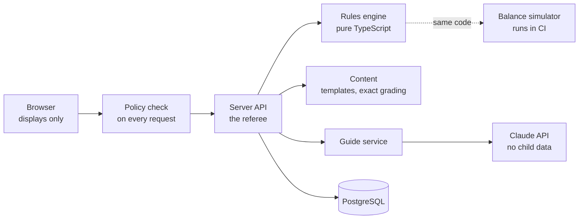

# BrickGenie: how it is built

BrickGenie is a Claude-tutored math game for pre-K through grade 8. It is live in production and in its first round of testing with invited families. The code is private, so this page describes how it is built and how it is checked.

I built it solo with AI coding agents. My part was the decisions, the rules the agents work under, and the checks that decide whether their work ships.

## At a glance

| | |
|---|---|
| Stack | One TypeScript app: Next.js and managed PostgreSQL, deployed on Vercel |
| Content | 241 concepts and 173 levels, kindergarten to grade 8 with pre-K counting beneath, mapped to Common Core |
| Schema | 61 tables, 53 forward-only migrations |
| Tests | 2,069 across 183 files, most of them driving real services against Postgres |
| Release gate | One command: type checks, lint, tests, content checker, balance simulator |
| AI | Claude as a tutor, never as a grader |
| Front end | Lighthouse 98-99 performance and 100 accessibility on every public page, with nothing loaded from a third party |

*Figures as of October 22, 2026.*

## Decisions everything else depends on

1. **The server is the referee.** The browser displays; the server grades and decides. A correct answer never reaches the browser before the student has answered.
2. **One pure rules engine.** The game's rules live in a package with no database, network, clock or randomness of its own. The server and the balance simulator call the same code, so a simulation is evidence about the real game.
3. **Tuned numbers live in versioned config,** and every result records the version it used, so old results stay explainable.
4. **Questions are generated from checked templates,** not drawn from a fixed bank, so every student sees fresh numbers.
5. **Grading is deterministic.** Exact rational arithmetic, never floating point. The model is not in the answer path, so it never decides whether an answer is right.
6. **Progress is a log, not a running total.** Totals are caches that can be rebuilt, every request that changes them can be retried safely, and a correction is a new entry.
7. **Student data points at stable content keys,** so a content release cannot orphan anyone's progress.

## The AI guide

- **The model was chosen by measurement.** I ran the same question through three Claude models. The cheapest per token was not the cheapest to run: its minimum cacheable prompt was larger than my prompt, so caching was accepted and silently did nothing. The mid-priced model cached the same prompt and came out at half the cost per warm call.
- **Prompts are built to cache.** The stable part comes first and is identical for every student. A test asserts that two builds of that part are byte-identical, because a cache that silently stops working looks exactly like one that works.
- **No free text from a child reaches the model.**
- **The server owns the conversation,** so the browser cannot steer the guide or run up the bill.
- **Every reply is checked before a child sees it.** A reply that fails the check is withheld and replaced with a friendly fallback, and flagged for review.
- **The guide is off during exams,** enforced on the server.
- **Spending is bounded,** and no limit is ever shown to a child as a limit on help.

## How I know it works

- **One command is the definition of done.** Type checks across every package, a type-aware lint, the test suite, the content checker (including an English pass over every template) and the balance simulator, which fails the build if the game stops being winnable at the accuracy it is tuned for. Every build ends in a secret-leak check.
- **Content was drafted with AI and then checked three ways:** an automated checker over every generated variant, sampling, and independent review passes. One audit of all 87,000 generated items found that 52% of multiple-choice questions carried a throwaway option; it is now 12%. A later teacher-style read of 3,240 generated items found no wrong answers. No subject expert has reviewed the content yet.
- **Audits found what tests could not.** Two full multi-agent audits and three security reviews, with every audit finding fixed alongside a regression test.
- **Hands-on play found what audits could not.** The first real play session turned up five defects while the suite was green the whole time.
- **Testers found what play could not.** The first written feedback from testers led to same-day fixes in how questions read.

## What I got wrong

- **More agents is not more thorough.** My first audit fanned out to about 280 parallel reviewers and exhausted its budget before producing anything. The rerun used seven agents with separate file ownership and finished the job.
- **The cheapest model was the most expensive to run.** I only found out because I measured.
- **A green test suite is not a working product.** Real use found what the suite could not.

## Privacy and access

Almost every user is under 13, so the data model starts from what not to collect: no real names, birth dates or emails for children, no third-party scripts in the student app, and no child data sent to the model. A child cannot start until parental consent is on file.

Access is decided on every request by one policy function with default deny, and a route without a policy line fails the tests. Parents can add an authenticator-app second step, download everything the account holds, and delete it.

## Not done yet

Payments, email and monitoring are deliberately out of the prototype. The tester round has not produced enough data yet to say whether children learn more or keep coming back. The product is instrumented to answer both.

The day-by-day build log is public: [AI engineering log](https://github.com/420yolomcswaggerpants/ai-engineering-log).
